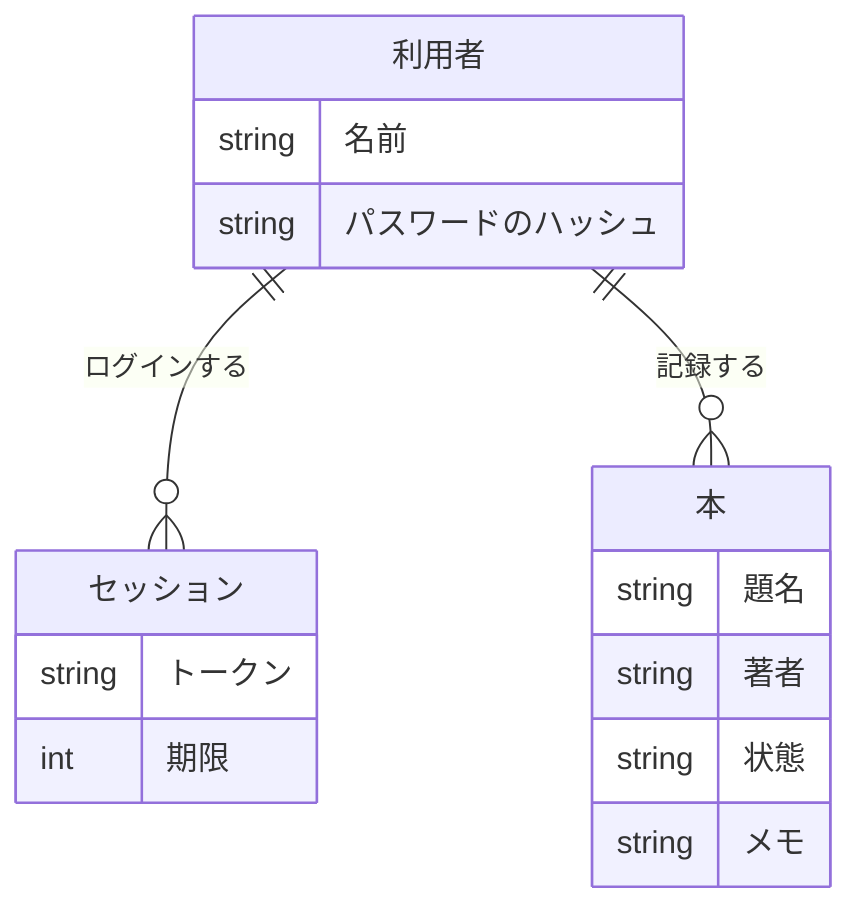

# ER図

| 項目 | 内容 |
|---|---|
| 文書名 | ER図 |
| 対象システム | 読書記録 |
| 版 | 1.0 |
| 作成日 | 2026年10月26日 |
| 作成者 | nsb |
| 関連資料 | 要件定義書、用語定義書、機能要件、画面見取り図、ユースケース、データベース設計、`frontend/app/app.vue` |
| 目的 | 利用者、セッション、本の関係を図で示す |

この資料は、関係の図です。言葉の意味は「用語定義書」に従います。作る範囲の正は「要件定義書」です。

この図は、論理的な関係です。表の項目の正は「データベース設計」です。データベースは SQLite です。題名、著者、状態、メモは、ログインした人の `books` の行に残します。確認用の RDS には移しません。ページを閉じても、その行は残ります。

## 1. この図の位置づけ

| 種類 | 内容 |
|---|---|
| この ER 図 | 利用者、セッション、本の論理的な関係 |
| いまの画面 | `frontend/app/app.vue`。ログイン欄と、自分の本の一覧 |
| 保存 | SQLite の `users`、`sessions`、`books`。実行環境は Durable Object のストレージ |

利用者は、SQLite の `users` です。ログインのあいだだけ `sessions` を持ちます。本は、その人の `books` です。1人は0件以上の本を持ちます。

## 2. 論理 ER 図

状態は、読みたい、読んでいる、読み終わったの3つです。メモは空でもよいです。

## 3. 表との対応

| 論理 | SQLite の表 | 画面 |
|---|---|---|
| 利用者 | `users` | ログイン欄の名前。ログイン後に表示する名前 |
| セッション | `sessions` | 画面には出さない。Cookie `session` と同じ値 |
| 本 | `books` | 追加欄と、本のカード |

他の利用者の本は、この関係の外には出しません。一覧も、更新も、削除も、自分の行だけです。

## 4. 改訂履歴

| 版 | 日付 | 内容 |
|---|---|---|
| 1.0 | 2026年10月26日 | 初版。利用者、セッション、本の関係を書いた |
