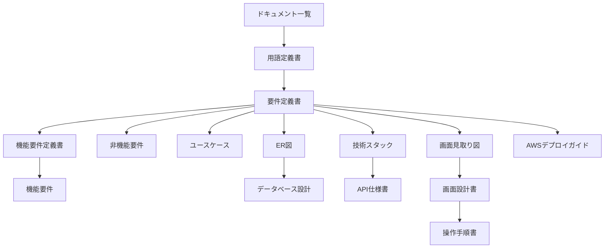

# ドキュメント一覧

| 項目 | 内容 |
|---|---|
| 文書名 | ドキュメント一覧 |
| 対象システム | 読書記録 |
| 版 | 1.0 |
| 作成日 | 2026年10月26日 |
| 作成者 | nsb |
| 関連資料 | 用語定義書、要件定義書、機能要件定義書、機能要件、非機能要件、ユースケース、ER図、データベース設計、技術スタック、API仕様書、画面見取り図、画面設計書、操作手順書、AWSデプロイガイド、`frontend/index.html` |
| 目的 | 資料を、どの順で読むかと、役割で引けるようにする |

この資料は、資料の入口です。何を作るか、何を作らないかの正は「要件定義書」です。言葉の意味の正は「用語定義書」です。

利用者は、登録した人です。画面は `frontend/index.html` の1枚です。バックエンドの言語は JavaScript、フレームワークは Hono です。ファイルは `backend/worker.js` で、実行環境は Cloudflare Workers です。経路は `durable-object/reading.js` です。データベースの言語は SQL、製品は SQLite です。SQLite は Durable Object のストレージです。EC2 は 2026年10月26日に起動しています。この版の Hono と SQLite は、その EC2 では動きません。PostgreSQL と RDS は置きません。

| 層 | 言語 | フレームワークまたは製品 | 場所 | いまあるもの |
|---|---|---|---|---|
| フロントエンド | HTML、CSS、JavaScript | なし | `frontend/index.html` | ログイン欄、本の追加、自分の本の一覧。CSS は `<style>`、JavaScript は `<script>` |
| バックエンド | JavaScript | Hono | `backend/worker.js` | `/api/` を Durable Object へ渡す。実行環境は Cloudflare Workers。`127.0.0.1:8787` |
| データベース | SQL | SQLite | `durable-object/reading.js` | `users`、`sessions`、アカウントごとの `books`。実行環境は Durable Object のストレージ |
| 資料 | | | `ドキュメント` | 言葉、範囲、機能、画面、データ、技術、API、手順 |

## 1. どの順で読むか

初めて読むときは上から順に見ます。目的が決まっているときは、次の節のグループから入ってください。

| 順番 | 資料 | 役割 |
|---|---|---|
| 1 | [用語定義書.md](./用語定義書.md) | 本、状態、アカウントなどの呼び方 |
| 2 | [要件定義書.md](./要件定義書.md) | 何を作るか、何を作らないか。番号の正は A-1 から A-3 と B-1 から B-4。完成の定義がある |
| 3 | [機能要件定義書.md](./機能要件定義書.md) | きっかけ、処理、事後条件 |
| 4 | [機能要件.md](./機能要件.md) | A-1 から A-3 と、B-1 から B-4 を引く一覧 |
| 5 | [非機能要件.md](./非機能要件.md) | 環境、残し方、費用、入力の長さ |
| 6 | [ユースケース.md](./ユースケース.md) | 利用の流れ。UC-1 から UC-8 |
| 7 | [ER図.md](./ER図.md) | 利用者、セッション、本の関係の図 |
| 8 | [データベース設計.md](./データベース設計.md) | SQLite の `users`、`sessions`、`books` |
| 9 | [技術スタック.md](./技術スタック.md) | 言語、フレームワーク、データベース、実行環境 |
| 10 | [API仕様書.md](./API仕様書.md) | `/api/` のパス、本体、状態コード |
| 11 | [画面見取り図.md](./画面見取り図.md) | どこに何を置くかの図 |
| 12 | [画面設計書.md](./画面設計書.md) | 部品の位置、表示、押したときの動き。画面IDは SCR-01 |
| 13 | [操作手順書.md](./操作手順書.md) | 起動と、画面での操作手順 |
| 14 | [AWSデプロイガイド.md](./AWSデプロイガイド.md) | EC2 の起動。2026年10月26日に1台起動した |

## 2. 目的から資料を選ぶ

### 言葉と範囲

呼び方は用語定義書です。何を作るか、何を作らないか、完成とみなす条件は要件定義書です。できることの定義は機能要件定義書、番号で引く一覧は機能要件です。環境、残し方、費用、入力の長さは非機能要件です。

### 利用の流れ

開く、登録する、本を追加する、直す、削除する流れはユースケースです。

### データ

関係の図は ER図です。表の項目はデータベース設計です。題名、著者、状態、メモは、ログインした人の `books` の行に残します。ページを閉じても、その行は残ります。

### 技術

使うものと使わないものは技術スタックです。フロントエンドの言語は HTML、CSS、JavaScript で、フレームワークはありません。バックエンドの言語は JavaScript、フレームワークは Hono、実行環境は Cloudflare Workers です。データベースは SQLite で、Durable Object のストレージです。パスは API仕様書です。手元では `http://127.0.0.1:8787` を開きます。EC2 は 2026年10月26日に起動しています。手順は AWSデプロイガイドです。

### 画面

先に形をつかむときは画面見取り図です。部品の表は画面設計書です。開き方と、押したときの手順は操作手順書です。サーバを起動せずに動かす画面は `prototype/index.html` です。記録は localStorage で、本実装の Durable Object の SQLite ではありません。

## 3. 資料の関係

図は GitHub 向けの Mermaid です。コードブロックの言語名を mermaid にし、流れは `flowchart`、データの関係は `erDiagram` で書いています。

## 4. 改訂履歴

| 版 | 日付 | 内容 |
|---|---|---|
| 1.0 | 2026年10月26日 | 初版。用語定義書から AWSデプロイガイドまで、読む順と役割を書いた |
