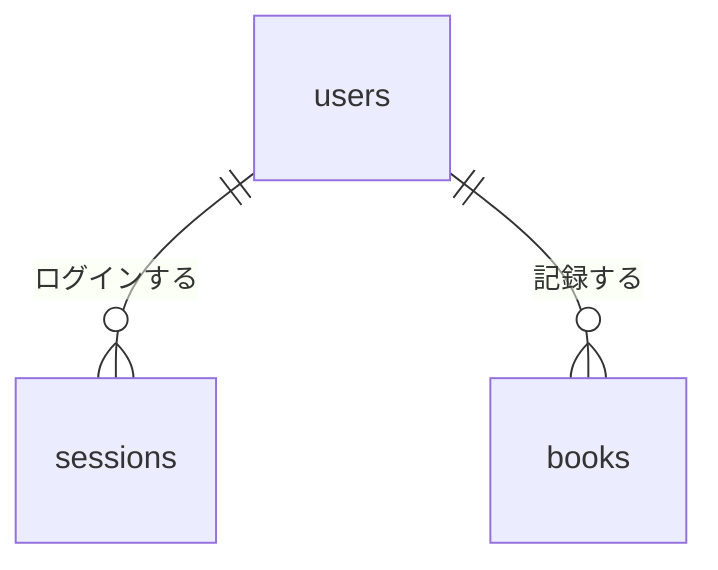

# データベース設計

| 項目 | 内容 |
|---|---|
| 文書名 | データベース設計 |
| 対象システム | 読書記録 |
| 版 | 1.0 |
| 作成日 | 2026年10月23日 |
| 作成者 | nsb |
| 関連資料 | 要件定義書、技術スタック、API仕様書 |
| 目的 | SQLite の表と列を決める |

データベースの言語は SQL、製品は SQLite です。ファイル名は `reading.db` です。

## 1. users

アカウントです。1人につき1行です。

| 列 | 型 | 約束 |
|---|---|---|
| id | INTEGER | 主キー |
| name | TEXT | 必須。重複しない。空白なしで1から32文字 |
| salt | TEXT | 必須。パスワードのソルト |
| password_hash | TEXT | 必須。PBKDF2-SHA-256。平文は残さない |

## 2. sessions

ログイン中のしるしです。Cookie `session` と同じ値を残します。

| 列 | 型 | 約束 |
|---|---|---|
| token | TEXT | 主キー。64文字の16進数 |
| user_id | INTEGER | 必須。users.id を指す |
| expires_at | INTEGER | 必須。期限。Unix 時刻の秒。発行から7日 |

## 3. books

本の記録です。必ず1人の利用者に属します。

| 列 | 型 | 約束 |
|---|---|---|
| id | INTEGER | 主キー |
| user_id | INTEGER | 必須。users.id を指す |
| title | TEXT | 必須。前後の空白を除いて1から80文字 |
| author | TEXT | 必須。前後の空白を除いて1から80文字 |
| status | TEXT | 必須。`want`、`reading`、`done` |
| memo | TEXT | 必須。空でもよい。400文字まで |

`want` は読みたい、`reading` は読んでいる、`done` は読み終わった、です。

他の利用者の行は、一覧にも更新にも削除にも出ません。
