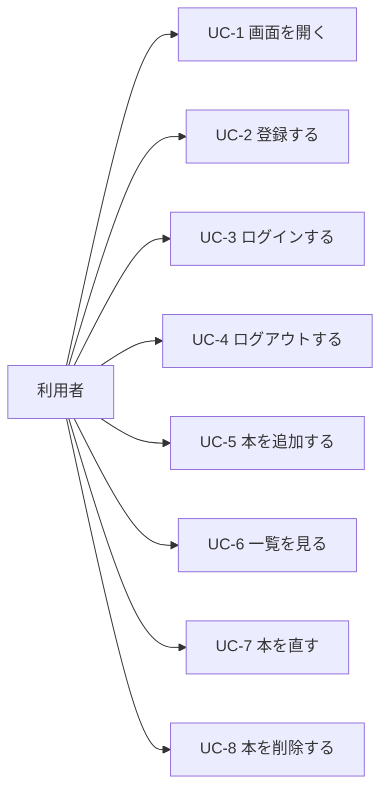
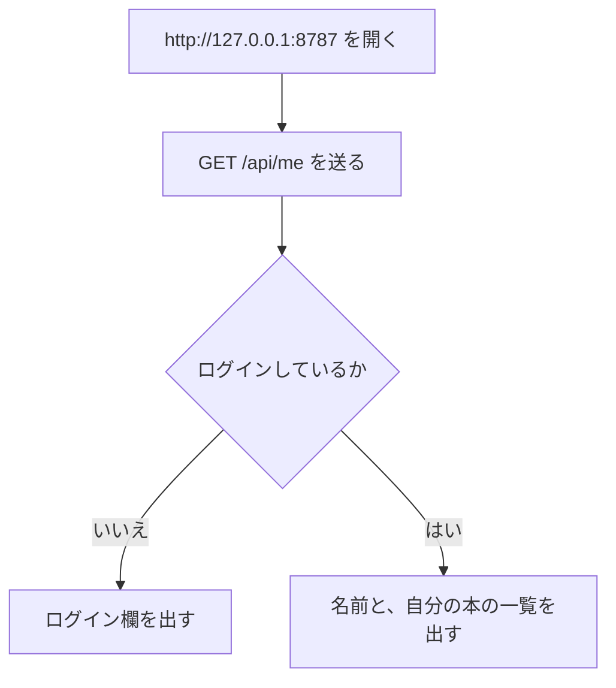
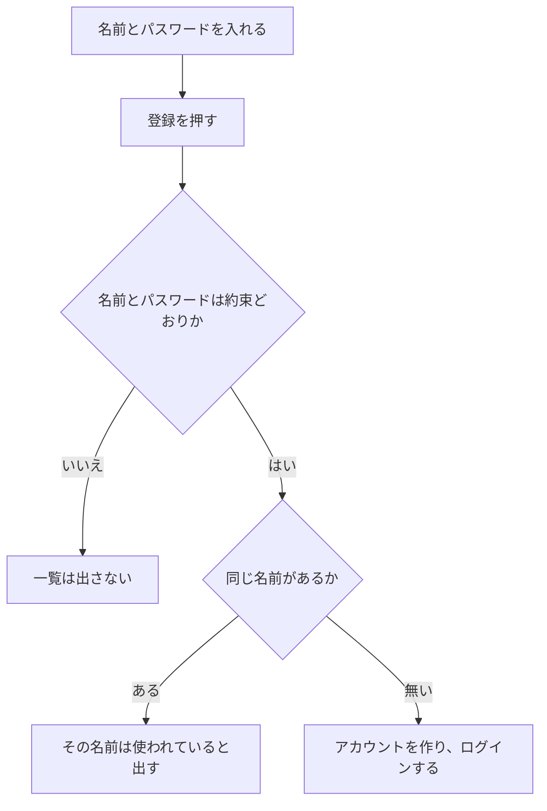
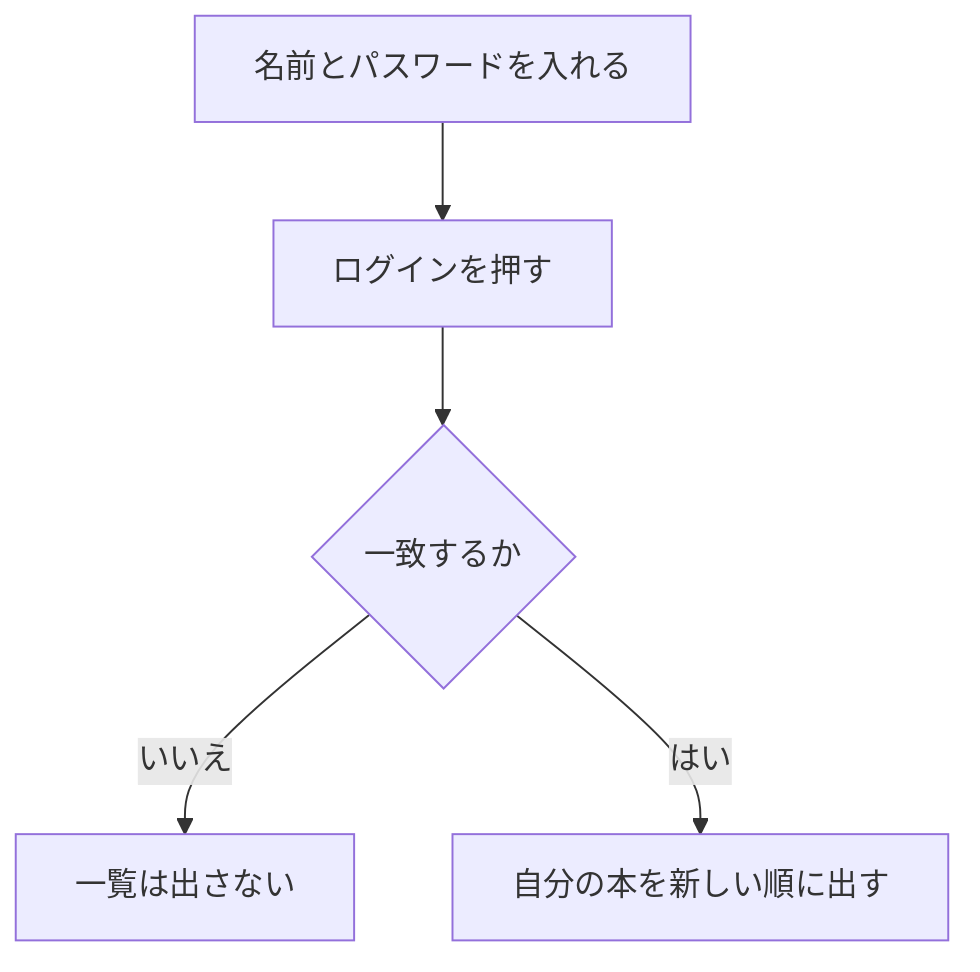
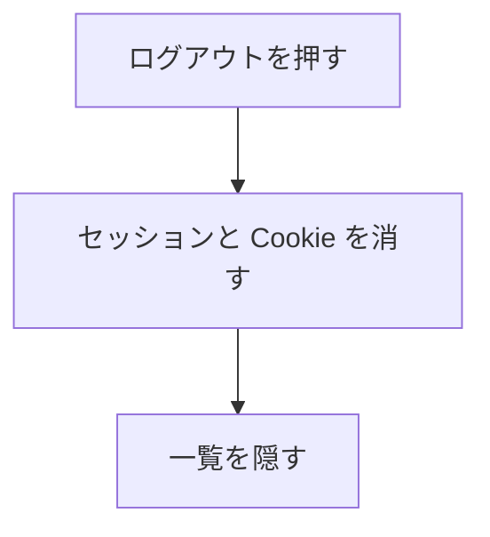
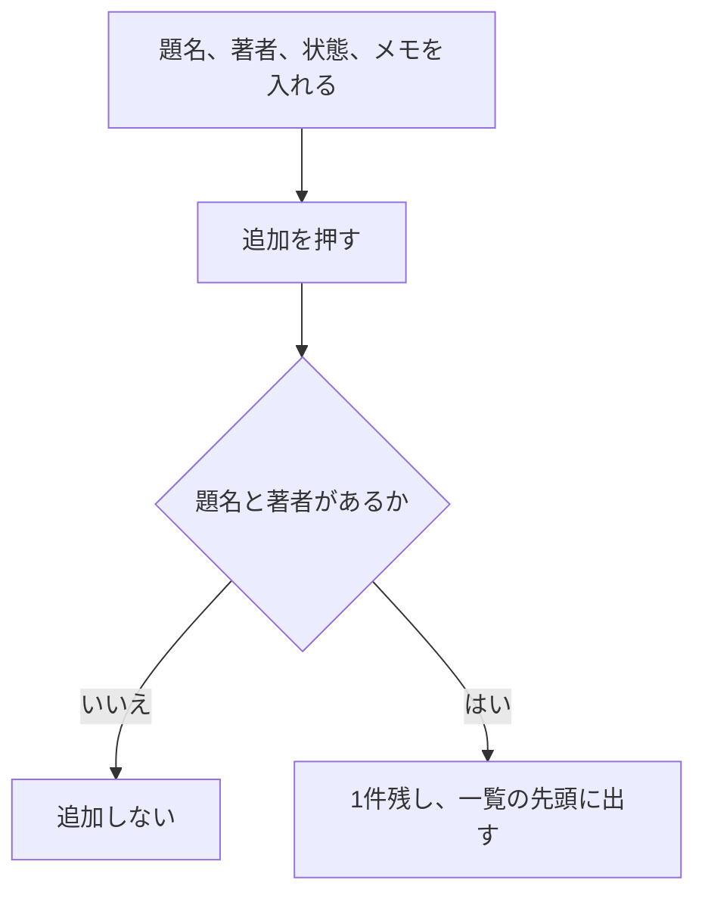
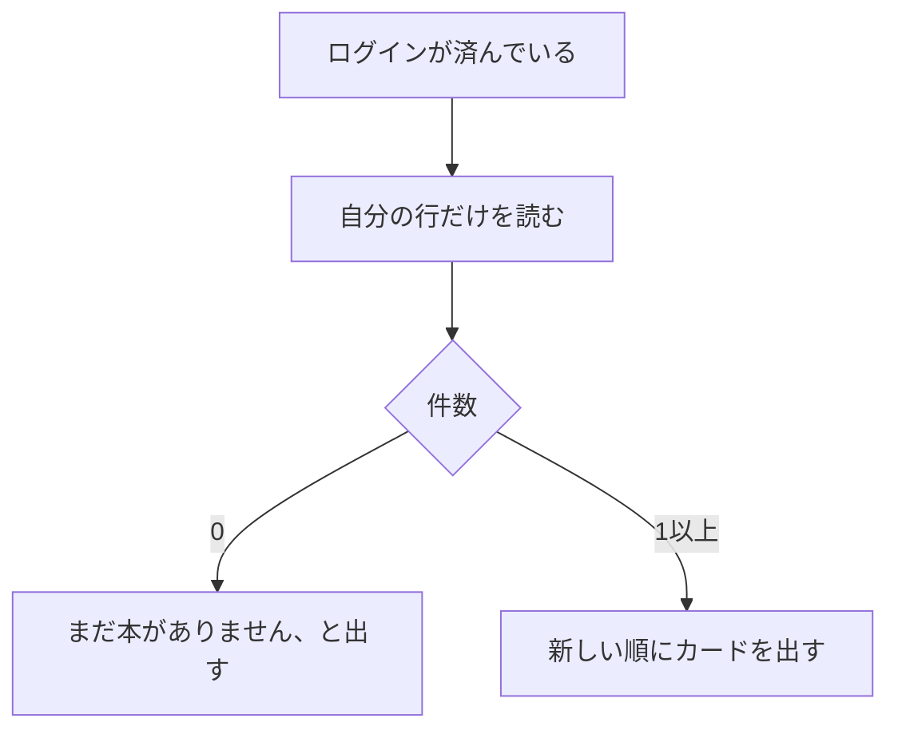
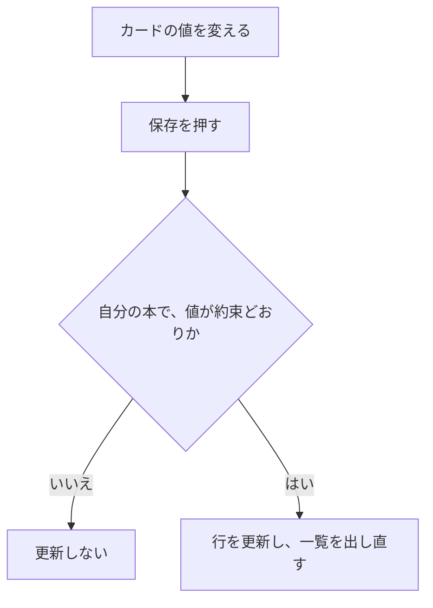
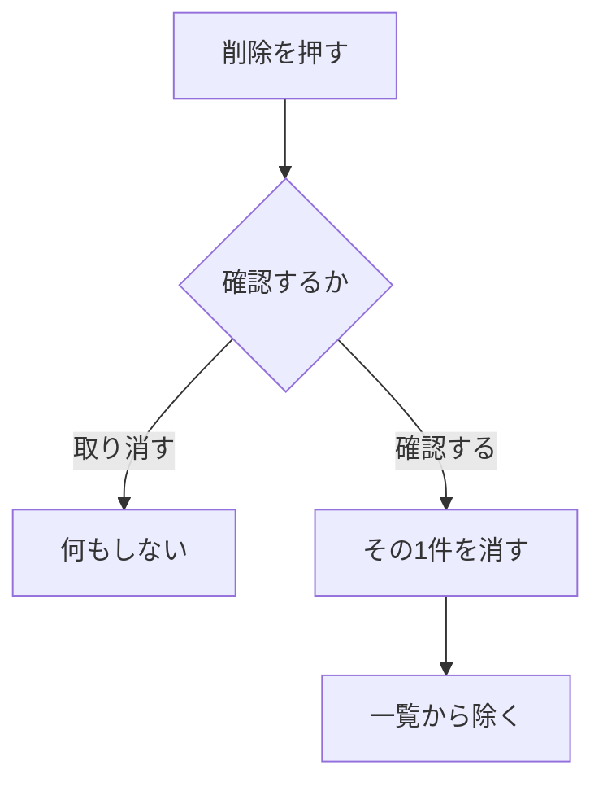

# ユースケース

| 項目 | 内容 |
|---|---|
| 文書名 | ユースケース |
| 対象システム | 読書記録 |
| 版 | 1.0 |
| 作成日 | 2026年10月26日 |
| 作成者 | nsb |
| 関連資料 | 要件定義書、用語定義書、機能要件、機能要件定義書、画面見取り図、ER図、`frontend/app/app.vue` |
| 目的 | 利用者が達成することを、流れで示す |

この資料は、利用の流れです。言葉の意味は「用語定義書」に従います。番号の正は「要件定義書」の「作ること」です。関係の図は「ER図」です。

新しい操作は、この資料では足しません。画面は1枚です。ファイルは `frontend/app/app.vue` です。

## 1. アクター

| アクター | 役割 |
|---|---|
| 利用者 | 登録した人。ログインしてから、自分の本を残す |

## 2. ユースケース図

## 3. UC-1 画面を開く

| 項目 | 内容 |
|---|---|
| アクター | 利用者 |
| 対応する機能 | A-2、B-2 |
| 事前条件 | 手元で Wrangler が `127.0.0.1:8787` を待っている |
| 事後条件 | ログインが無ければ、ログイン欄だけが見える。ログインが残っていれば、自分の本の一覧が見える |

## 4. UC-2 登録する

| 項目 | 内容 |
|---|---|
| アクター | 利用者 |
| 対応する機能 | A-1、B-2 |
| 事前条件 | ログインしていない。名前はまだ使われていない |
| 事後条件 | ログインしている。一覧は0件から始まる |

## 5. UC-3 ログインする

| 項目 | 内容 |
|---|---|
| アクター | 利用者 |
| 対応する機能 | A-2、B-2 |
| 事前条件 | その名前が登録されている |
| 事後条件 | 自分の本だけが見える |

## 6. UC-4 ログアウトする

| 項目 | 内容 |
|---|---|
| アクター | 利用者 |
| 対応する機能 | A-3 |
| 事前条件 | ログインしている |
| 事後条件 | ログイン欄に戻る。本の行は SQLite に残る |

## 7. UC-5 本を追加する

| 項目 | 内容 |
|---|---|
| アクター | 利用者 |
| 対応する機能 | B-1、B-2 |
| 事前条件 | ログインしている |
| 事後条件 | その本が一覧の先頭に出る |

## 8. UC-6 一覧を見る

| 項目 | 内容 |
|---|---|
| アクター | 利用者 |
| 対応する機能 | B-2 |
| 事前条件 | ログインしている |
| 事後条件 | 自分の本だけが、新しい順に見える。0件なら空の案内が出る |

## 9. UC-7 本を直す

| 項目 | 内容 |
|---|---|
| アクター | 利用者 |
| 対応する機能 | B-3 |
| 事前条件 | ログインしている。そのカードが自分の本である |
| 事後条件 | 題名、著者、状態、メモが更新され、開き直しても残る |

## 10. UC-8 本を削除する

| 項目 | 内容 |
|---|---|
| アクター | 利用者 |
| 対応する機能 | B-4、B-2 |
| 事前条件 | ログインしている。そのカードが自分の本である |
| 事後条件 | 確認した本だけが一覧から消える |

## 11. 改訂履歴

| 版 | 日付 | 内容 |
|---|---|---|
| 1.0 | 2026年10月26日 | 初版。UC-1 から UC-8 の流れを書いた |
